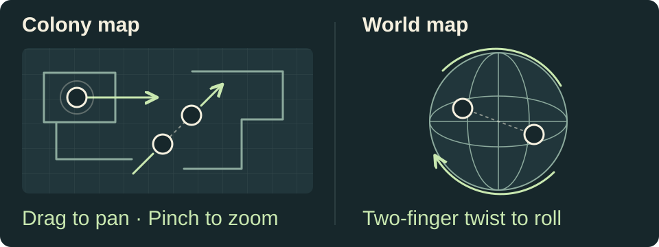

# RimTouch

Touch controls for **RimWorld 1.7 on Windows**. Pan and zoom your colony, select pawns, scroll menus, and navigate the world map with your fingers.

English · [简体中文](README.zh-CN.md)

**Stable release: 0.2.0** · [Download ZIP](https://github.com/Stella-sea/rimworld-rimtouch/releases/download/v0.2.0/RimTouch-v0.2.0.zip) · [Release notes](https://github.com/Stella-sea/rimworld-rimtouch/releases/tag/v0.2.0) · [Steam Workshop](https://steamcommunity.com/sharedfiles/filedetails/?id=3827698857)

Requires a Windows touchscreen, RimWorld 1.7, and [Harmony](https://steamcommunity.com/sharedfiles/filedetails/?id=2009463077), installed and enabled separately. Mouse controls remain available.



*Schematic gesture guide. See the controls below for selection and command gestures.*

[Install](#install) · [Controls](#controls) · [Settings](#settings) · [Troubleshooting](#troubleshooting) · [Project documentation](#project-documentation)

## Install

1. Download **`RimTouch-v0.2.0.zip`** from the [0.2.0 release](https://github.com/Stella-sea/rimworld-rimtouch/releases/tag/v0.2.0). GitHub's automatic "Source code" archives do not contain the compiled mod.
2. Extract the ZIP into `RimWorld/Mods/`. It contains one `RimTouch/` folder; the result should include `RimWorld/Mods/RimTouch/About/About.xml` and `RimWorld/Mods/RimTouch/Assemblies/RimTouch.dll`.
3. Enable Harmony and RimTouch in the game's mod list. Enable **only one RimTouch implementation**: choose the local copy or the Workshop copy, and disable any original or other continuation alongside it.
4. Open the game's mod settings and select **RimTouch**. Touch mode is on by default; the `Input` status shows whether the Windows touch backend is available.

When updating a local copy, close the game and replace the complete `RimTouch/` folder, including `Languages/` and the license notices. Replacing only the DLL leaves translated settings text out of date.

The [Workshop item](https://steamcommunity.com/sharedfiles/filedetails/?id=3827698857) is a separate distribution channel. Publishing a GitHub release does not update Workshop; check its version before choosing where to install.

## Controls

### Colony map

| Gesture | Action |
| --- | --- |
| Short tap | Select a nearby object or pawn; tap empty ground to clear selection. With a drafted pawn selected, a tap instead attempts a command at that location, using the game's default action or opening its command menu. |
| Double tap | Select visible things of the same type. For pawns, the selection also matches faction. This applies when the tap is selecting rather than issuing a drafted-pawn command. |
| Drag one finger | Pan the camera. Start moving without pausing for a hold. |
| Hold, then drag | Hold still for about **0.32 seconds**, then drag to draw a selection box. Begin the drag before the longer command hold below. |
| Hold still | At about **0.50 seconds**, open the contextual command menu if pawns are selected and commands are available. |
| Pinch / move two fingers together | Zoom / pan, with adjustable inertia after release. |
| Short two-finger tap | Cancel an active colony-map designator or targeting tool. Otherwise, with a drafted pawn selected, select near the contacts or clear selection on empty ground. |
| Double tap a colonist portrait | Jump the camera to that colonist and select them. |

Active construction, designation and targeting tools keep their normal single-finger input path.

### World map

| Gesture | Action |
| --- | --- |
| Short tap | Select a tile or world object. Tap empty space outside the globe to clear selection. |
| Drag one finger | Move the view in your finger's screen direction, including drags starting outside the globe. Default dual-axis mode preserves the current roll and limits pitch near the poles. |
| Pinch / move two fingers together | Zoom / move the view. |
| Twist two fingers | Roll the view after a deliberate twist (default trigger: **10°**). Use the game's **North-up** control to straighten it again. |
| Double tap, keep the second contact down, then drag | Draw a world selection box when point-and-drag is enabled (on by default). Start the second contact near the first within **0.30 seconds**. |

### Menus and windows

Tap buttons and tabs, swipe vertically inside scrollable content, and drag sliders along their axis. In supported scroll views, a vertical swipe starting on a horizontal slider scrolls the content without changing its value. Start a new drag at a window's border to move the window.

Gestures starting in a blocking window or an active scroll view stay with that UI when a second finger is added. UI tap repair and release guards reduce background selection and stray clicks after gestures; custom UI has the limits described under [compatibility](#compatibility).

## Settings

RimTouch includes English and Simplified Chinese settings text. Open **RimTouch** in the game's mod settings to adjust camera feel, world gestures and UI scaling.

<details>
<summary>Settings and defaults</summary>

These are defaults for a new configuration; saved preferences and migrations can affect an existing installation.

| Setting | Default and behavior |
| --- | --- |
| Enable touch mode | **On.** Enables direct gestures and UI tap repair. |
| Two-finger globe twist | **On.** Trigger **10°**, adjustable from 3° to 20°. A higher angle reduces accidental twists; a gesture already classified as a pinch or pan will not become a twist. |
| Dual-axis mode | **On.** Screen-relative world dragging that preserves the current roll. Turn it off for free anchor dragging, including roll. |
| Turntable drag speed / invert rotation axis | **1.00× / off.** Speed is adjustable from 0.50× to 2.00× in dual-axis mode; inversion reverses the drag direction. |
| Auto-return to north / duration | **On / 0.80 seconds.** Applies with dual-axis mode off: a single-finger anchor drag starts the smooth return. Duration is adjustable from 0.30 to 2.00 seconds. |
| Point-and-drag to multi-select on the globe | **On.** Enables the double-tap-and-drag selection box. Turn it off to pan with that gesture. |
| Pan inertia strength / damping | **1.05 / 4.80.** Strength 0 to 2; damping 1 to 10. |
| Zoom inertia strength / damping | **1.05 / 4.80.** Strength 0 to 2; damping 1 to 10. |
| Enable extended zoom range | **On.** Colony-camera size bounds **5 to 120**. Minimum is adjustable from 0.5 to 11; maximum from 60 to 300. These are camera sizes, not zoom multipliers. |
| Allow extra UI scales (advanced) | **Off.** Opts into scale choices outside the game's normal resolution checks, when the game build supports the hook. |
| Temporarily log touch diagnostics to Debug log | **Off, not saved.** Each capture stops after 1024 records. |

**Reset touch tuning** restores inertia defaults. Zoom bounds apply live; **Apply zoom range now** and **Reset zoom range to default** are also available. Disabling extended zoom restores the prior bounds only while RimTouch still owns them, to avoid overwriting another mod's changes.

**Reset UI scale to 1.0x** also turns off extra UI scales. If the hook is unavailable, RimTouch keeps the game's native scale choices.

</details>

## Troubleshooting

If gestures are missing, check Windows touch input, the RimTouch `Input` status, Harmony, and that only one RimTouch implementation is enabled. If only settings translations look stale, replace the whole mod folder. For UI scaling trouble, use **Reset UI scale to 1.0x**.

To report an interaction problem:

1. In RimTouch settings, enable **Temporarily log touch diagnostics to Debug log**.
2. Reproduce the problem briefly, stop capture, then press **Copy compact touch diagnostics**.
3. [Open a bug report](https://github.com/Stella-sea/rimworld-rimtouch/issues/new) with the expected and actual behavior, steps to reproduce, mod version/list, game version, window mode, UI/system scaling, and touch device. Paste the compact diagnostics; include the relevant normal Debug log if an exception appeared or the copy is incomplete.

No launch arguments, restart or separate output file are needed. The checkbox is not saved; capture stops after **1024 records**. Copy before enabling it again, because a new capture clears the previous buffer. The compact copy omits per-entry stack traces; the normal Debug log stays available.

See the [capture guide](docs/input-diagnostics.md) for buffer limits, diagnostic fields and optional legacy capture flags. Check [existing issues](https://github.com/Stella-sea/rimworld-rimtouch/issues) before filing a duplicate.

### Compatibility

- This continuation targets **Windows and RimWorld 1.7**. Other operating systems and game versions are unsupported.
- The fixes included in 0.2.0 passed user hardware acceptance. That does not establish compatibility with every touchscreen, renderer, display scale or mod combination.
- Standard event and control handling lets RimTouch prevent UI taps from also selecting the map. Completely custom UI that neither consumes events nor reports operations through supported controls may still conflict.
- General control acquisition for **drag, hold and multitouch** remains follow-up work. The UI tap fixes do not imply that every custom gesture is covered.
- Touch cancellation, focus loss and view changes clear active input and inertia. If the touch backend is unavailable, mouse input remains available.

## Project documentation

| Document | What it covers |
| --- | --- |
| [Changelog](CHANGELOG.md) | Version history, accepted fixes and release verification. |
| [Releases](RELEASES.md) | Download channels, archive contents, versioning and release procedure. |
| [Contributing](CONTRIBUTING.md) | Development branches, PRs and required checks. |
| [Build status](BUILD-STATUS.md) | Dated build and release-preparation evidence with its limits; not a live CI dashboard. |
| [Source snapshot](Source-Snapshot.json) | Historical original snapshot hashes; not a claim that the current source is unchanged. |
| [Touch findings](docs/ui-touch-findings.md) | Investigation history, hardware feedback and compatibility boundaries. |

Stable releases are tagged on `main`; ongoing integration and prereleases use `dev`. The [source at `v0.2.0`](https://github.com/Stella-sea/rimworld-rimtouch/tree/v0.2.0) corresponds to the released program.

<details>
<summary>Build from source for RimWorld 1.7</summary>

Use PowerShell 7, an installed .NET SDK, at least 1.5 GB of free space, and your licensed RimWorld 1.7 assemblies plus the matching Harmony DLL. `GameDir` must directly contain `Version.txt`, `Assembly-CSharp.dll` and the other required game DLLs.

```powershell
pwsh -File ./Build17.ps1 -GameDir 'PATH/TO/RIMWORLD' -HarmonyDll 'PATH/TO/0Harmony.dll'
```

The supported helper compiles `Source/` into `.build/1.7/` and writes a build receipt. Each successful build refreshes one complete local test mod at `.build/local/RimTouch/`; a failed compilation preserves the previous usable copy. It does not download dependencies, install the mod or start the game. The legacy project file is not the supported build entry.

See [Contributing](CONTRIBUTING.md) for the checks that require no game installation and the local Harmony audit. Compilation and stub tests do not replace touchscreen testing.

</details>

## Credits and license

Original RimTouch by **Tatsuki Tanaka**: [iLtanaka/RimTouch](https://github.com/iLtanaka/RimTouch). Windows continuation by **Sweet Briana and Cinder**.

The program and continuation are licensed under **GPL-3.0-or-later**. See [LICENSE](LICENSE) and [CREDITS.md](CREDITS.md). Preview artwork retains its creator's rights under [ASSETS.md](ASSETS.md); the original README gesture diagrams have [their own license notice](docs/images/README.md).

Package ID: `cinder.rimtouch17.private` · Workshop ID: `3827698857`. The historical package suffix is retained for identity; **0.2.0 is a stable release**.
