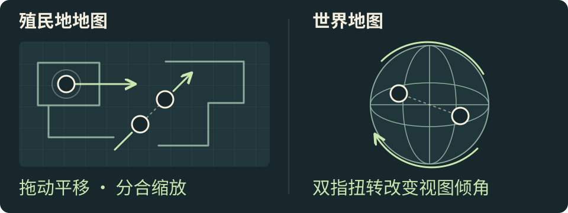

# RimTouch

为 **Windows 上的 RimWorld 1.7** 提供触控操作。用手指平移、缩放殖民地地图，选择角色、滚动菜单，以及浏览世界地图。

[English](README.md) · 简体中文

**当前稳定版：0.2.0** · [下载 ZIP](https://github.com/Stella-sea/rimworld-rimtouch/releases/download/v0.2.0/RimTouch-v0.2.0.zip) · [版本说明](https://github.com/Stella-sea/rimworld-rimtouch/releases/tag/v0.2.0) · [Steam 创意工坊](https://steamcommunity.com/sharedfiles/filedetails/?id=3827698857)

需要 Windows 触摸屏、RimWorld 1.7，以及单独安装并启用的 [Harmony](https://steamcommunity.com/sharedfiles/filedetails/?id=2009463077)。鼠标操作仍然可用。



*手势示意图。选择与命令操作见下方说明。*

[安装](#安装) · [操作](#操作) · [设置](#设置) · [排障与反馈](#排障与反馈) · [项目文档](#项目文档)

## 安装

1. 从 [0.2.0 发布页](https://github.com/Stella-sea/rimworld-rimtouch/releases/tag/v0.2.0)下载 **`RimTouch-v0.2.0.zip`**。GitHub 自动生成的“Source code”压缩包不含编译好的模组。
2. 将 ZIP 解压到 `RimWorld/Mods/`。压缩包只有一层 `RimTouch/` 根目录；解压后应能找到 `RimWorld/Mods/RimTouch/About/About.xml` 和 `RimWorld/Mods/RimTouch/Assemblies/RimTouch.dll`。
3. 在游戏模组列表中启用 Harmony 和 RimTouch。**只启用一个 RimTouch 实现**：本地版与工坊版二选一，同时停用原版或其他续作。
4. 打开游戏的模组设置，选择 **RimTouch**。触控模式默认开启，“输入”状态会显示 Windows 触控后端是否可用。

更新本地版时，先关闭游戏，再替换完整的 `RimTouch/` 目录，包括 `Languages/` 和许可说明。只替换 DLL 不会更新设置页的翻译文本。

[工坊条目](https://steamcommunity.com/sharedfiles/filedetails/?id=3827698857)单独维护。GitHub 发版不会自动更新工坊；选择安装渠道前，请查看对应版本。

## 操作

### 殖民地地图

| 手势 | 操作 |
| --- | --- |
| 短点按 | 选择附近的物体或角色，点空地取消选择。已选中征召角色时，点按会优先尝试在该位置发出命令，执行游戏默认动作或打开命令菜单。 |
| 双击 | 选择视野内同类物体；角色还须属于同一派系。此行为适用于点按正在选择目标、而非向征召角色发命令时。 |
| 单指拖动 | 平移镜头，起手后直接移动，不要先停留长按。 |
| 按住后拖动 | 静止约 **0.32 秒**后拖动进入框选。请在触发下述更长的命令长按之前开始拖动。 |
| 持续静止长按 | 约 **0.50 秒**时，若已选中角色且该处有可用命令，则打开上下文命令菜单。 |
| 双指分合／双指同向移动 | 缩放／平移，松手后的惯性可调。 |
| 双指短点按 | 取消当前殖民地地图的指定或目标选择工具。没有此类工具且已选中征召角色时，改为选择触点附近的目标，点空地则取消选择。 |
| 双击殖民者头像 | 将镜头移到该殖民者并选中。 |

建造、指定及目标选择工具处于活动状态时，保留其原本的单指输入路径。

### 世界地图

| 手势 | 操作 |
| --- | --- |
| 短点按 | 选择地块或世界物体。点地球外的空白处取消选择。 |
| 单指拖动 | 按手指的屏幕方向移动视角，也支持从球外空白处起拖。默认双轴模式保留当前滚转倾角，并在接近两极时限制俯仰。 |
| 双指分合／双指同向移动 | 缩放／移动视角。 |
| 双指扭转 | 明确扭转后改变视图的滚转倾角，默认触发角度为 **10°**。使用游戏的“北向上”按钮可回正。 |
| 双击，第二次按住后拖动 | 开启“点按拖动”时画出世界选择框，默认开启。第二次触摸应在首次点按后 **0.30 秒**内落在附近。 |

### 菜单与窗口

点按按钮和标签页，在可滚动内容内上下滑动，沿滑杆方向拖动以调整数值。在支持的滚动视图中，从水平滑杆上开始的竖向滑动会滚动内容，并保持滑杆数值。需要移动窗口时，抬手后从窗口边缘重新起拖。

从阻挡地图输入的窗口或已接管手势的滚动区起手，增加第二指后仍由该 UI 处理。UI 点按修复与释放保护用于减少背景误选和手势后的误点击；自定义界面的限制见[兼容范围](#兼容范围)。

## 设置

RimTouch 的设置文本提供英文与简体中文。打开游戏模组设置中的 **RimTouch**，可调整镜头手感、世界手势和 UI 缩放。

<details>
<summary>设置项与默认值</summary>

以下为新配置的默认值；已有安装的实际值还受保存的偏好与配置迁移影响。

| 设置 | 默认值及行为 |
| --- | --- |
| 启用触控模式 | **开启。** 启用直接触控手势和 UI 点按修复。 |
| 双指旋转地球 | **开启。** 触发角度 **10°**，可调范围 3° 至 20°。角度越大越不易误触；已判定为缩放或平移的手势不会再转为扭转。 |
| 双轴模式 | **开启。** 按屏幕方向拖动世界视角，保留当前滚转倾角。关闭后使用包含滚转的自由抓点拖动。 |
| 转盘拖动速度／反转旋转轴 | **1.00 倍／关闭。** 双轴模式的速度可在 0.50 至 2.00 倍间调整；反转会翻转拖动方向。 |
| 自动回正到北方／所需时间 | **开启／0.80 秒。** 双轴模式关闭时，单指抓点拖动会启动平滑回正。时间可调范围 0.30 至 2.00 秒。 |
| 点按拖动：在地球上多选 | **开启。** 双击后按住拖动可框选；关闭后该手势改为平移。 |
| 平移惯性强度／阻尼 | **1.05／4.80。** 强度范围 0 至 2，阻尼范围 1 至 10。 |
| 缩放惯性强度／阻尼 | **1.05／4.80。** 强度范围 0 至 2，阻尼范围 1 至 10。 |
| 启用扩展缩放范围 | **开启。** 殖民地镜头尺寸上下限为 **5 至 120**。最小值可调范围 0.5 至 11，最大值为 60 至 300。这些数值是镜头尺寸，不是缩放倍数。 |
| 允许额外 UI 缩放（高级） | **关闭。** 游戏版本支持相应补丁时，允许选择超出原版分辨率检查的缩放比例。 |
| 临时记录触控诊断（调试日志） | **关闭，不保存。** 每轮最多记录 1024 条。 |

“重置触控调校”恢复惯性默认值。镜头缩放范围会实时应用，也可使用“立即应用缩放范围”和“重置缩放范围为默认值”。关闭扩展缩放时，仅在 RimTouch 仍持有该范围的情况下恢复之前的上下限，以免覆盖其他模组的修改。

“重置 UI 缩放为 1.0x”也会关闭额外缩放。若相应补丁不可用，则保留游戏原生的缩放选项。

</details>

## 排障与反馈

手势无效时，检查 Windows 触控、RimTouch 的“输入”状态、Harmony，以及是否只启用了一个 RimTouch 实现。只有设置翻译过旧时，请替换完整模组目录。UI 缩放异常时，可使用“重置 UI 缩放为 1.0x”。

反馈交互问题时：

1. 在 RimTouch 设置中勾选“临时记录触控诊断（调试日志）”。
2. 简短复现问题，停止记录，再点击“复制精简触控诊断”。
3. [提交 Bug 报告](https://github.com/Stella-sea/rimworld-rimtouch/issues/new)，说明预期和实际表现、复现步骤、模组版本与列表、游戏版本、窗口模式、UI／系统缩放以及触控设备。粘贴精简诊断；若出现异常或复制内容不完整，再附相关的原生调试日志。

无需启动参数、重启或另找输出文件。此开关不保存，每轮最多 **1024 条**。重新勾选会清空上一轮缓冲，请先复制。精简诊断不含逐条调用栈，游戏原生调试日志仍然保留。

缓冲上限、诊断字段和旧版可选采集参数见[采集指南](docs/input-diagnostics.md)。提交前可先查看[已有问题](https://github.com/Stella-sea/rimworld-rimtouch/issues)，避免重复反馈。

### 兼容范围

- 本续作面向 **Windows 与 RimWorld 1.7**，不支持其他操作系统和游戏版本。
- 0.2.0 所涉及的修复已通过用户实机验收；这不代表覆盖了所有触摸屏、渲染器、显示缩放和模组组合。
- 通过标准事件和控件处理，RimTouch 可避免 UI 点按同时选中背景地图。完全自绘、既不消费事件也不经受支持控件报告操作的界面仍可能冲突。
- **拖动、长按和双指**的通用控件接管仍属后续工作。UI 点按修复不代表已覆盖所有自定义手势。
- 触控取消、失焦和视图切换会清理活动输入与惯性。触控后端不可用时，鼠标仍可操作。

## 项目文档

| 文档 | 内容 |
| --- | --- |
| [更新日志](CHANGELOG.md) | 版本历史、已验收修复及发布验证。 |
| [发布说明](RELEASES.md) | 下载渠道、压缩包内容、版本规则和发版流程。 |
| [参与贡献](CONTRIBUTING.md) | 开发分支、PR 和必需检查。 |
| [构建记录](BUILD-STATUS.md) | 带日期的构建与发布准备证据及其限制，不是实时 CI 状态页。 |
| [源快照](Source-Snapshot.json) | 原始快照的历史哈希，不表示当前源码仍未改动。 |
| [触控排查记录](docs/ui-touch-findings.md) | 排查过程、实机反馈与兼容边界。 |

稳定版在 `main` 上打标签；日常集成与预发布使用 `dev`。[`v0.2.0` 标签下的源码](https://github.com/Stella-sea/rimworld-rimtouch/tree/v0.2.0)对应已发布的程序。

<details>
<summary>从源码构建 RimWorld 1.7 版</summary>

需要 PowerShell 7、已安装的 .NET SDK、至少 1.5 GB 可用空间、合法的 RimWorld 1.7 游戏程序集和匹配的 Harmony DLL。`GameDir` 应直接包含 `Version.txt`、`Assembly-CSharp.dll` 及其他所需游戏 DLL。

```powershell
pwsh -File ./Build17.ps1 -GameDir 'PATH/TO/RIMWORLD' -HarmonyDll 'PATH/TO/0Harmony.dll'
```

受支持的构建脚本将 `Source/` 编译到 `.build/1.7/` 并写入构建收据。每次成功构建会刷新 `.build/local/RimTouch/` 这一份完整本地测试模组；编译失败会保留上一份可用版本。脚本不下载依赖、不安装模组，也不启动游戏。旧项目文件不是受支持的构建入口。

免游戏依赖检查与本地 Harmony 审核见[参与贡献](CONTRIBUTING.md)。编译和桩测试不能代替触摸屏实测。

</details>

## 署名与许可

RimTouch 原作者：**Tatsuki Tanaka**，上游仓库 [iLtanaka/RimTouch](https://github.com/iLtanaka/RimTouch)。Windows 续作：**Sweet Briana 和 Cinder**。

程序及续作采用 **GPL-3.0-or-later**，见 [LICENSE](LICENSE) 与 [CREDITS.md](CREDITS.md)。预览图保留创作者的权利，遵循 [ASSETS.md](ASSETS.md)；README 原创手势图另有[许可说明](docs/images/README.md)。

包 ID：`cinder.rimtouch17.private` · 工坊 ID：`3827698857`。包名的历史后缀用于保留身份，**0.2.0 为稳定版**。
